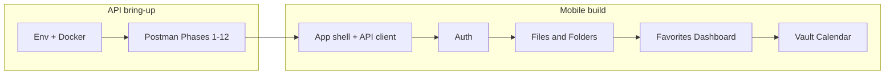

# Phase-by-Phase: API Bring-Up + React Native App

The API in [`apps/api`](apps/api) already implements all Postman phases 1–12. The mobile app in [`apps/mobile`](apps/mobile) is still the Expo Router starter (Home/Explore tabs only)—no API client, auth, or file-manager screens. This plan mirrors [`apps/api/postman_collection.json`](apps/api/postman_collection.json): **verify the backend phase-by-phase, then ship matching mobile UI.**



---

## Part A — Get the API running

### A0. Environment and start

1. In [`apps/api`](apps/api): ensure [`.env`](apps/api/.env) matches [`.env.example`](apps/api/.env.example) (`PORT=8080`, `MONGODB_URI`, `JWT_SECRET`).
2. **Minimum to start:** MongoDB + JWT. Google OAuth and SMTP can wait until Phases 3–4.
3. Preferred start (from [`apps/api`](apps/api)):

```bash
docker compose up --build
```

Or locally: MongoDB running, then `npm install` + `npm run dev`.

4. Confirm: `GET http://localhost:8080/api/health` returns success.
5. Import [`postman_collection.json`](apps/api/postman_collection.json); `base_url` = `http://localhost:8080`.

**Mobile networking note (do later in Part B):** physical devices need the host LAN IP (not `localhost`); Android emulator often uses `10.0.2.2:8080`. Keep `CORS_ORIGIN=*` for Expo web during development.

### A1–A12. Verify against Postman (do in order)

| Phase                  | What to prove                                                           | Blockers / notes                                                               |
| ---------------------- | ----------------------------------------------------------------------- | ------------------------------------------------------------------------------ |
| **1 Foundation**       | Health + 404                                                            | None                                                                           |
| **2 Auth**             | Signup → login → logout; tokens auto-captured                           | None                                                                           |
| **3 Profile / OTP**    | Profile update, change password, forgot → verify OTP → reset            | Needs real `SMTP_*` or accept OTP from API/console in dev                      |
| **4 Google OAuth**     | Browser flow to `/api/auth/google`                                      | Needs `GOOGLE_CLIENT_*` + callback URL; optional for mobile email/password MVP |
| **5 Files**            | Upload, list (`?type=`), detail, download                               | PDF/image/doc only; 50MB; field name `file`                                    |
| **6 Folders**          | Create root/subfolder, upload with `folderId`, contents, rename, delete | Recursive delete cleans disk                                                   |
| **7 Advanced files**   | Rename, duplicate, delete                                               | Copy exists in API; lightly covered in Postman                                 |
| **8 Favorites**        | Add/list/remove file & folder                                           |                                                                                |
| **9 Dashboard**        | Storage, type stats, recent items                                       |                                                                                |
| **10 Vault**           | Set/verify PIN, move, list with `x-vault-pin`, download, restore        | Known gap: vault items may still appear in normal lists—fix and note           |
| **11 Calendar**        | `GET /api/calendar?date=YYYY-MM-DD`                                     | Use ISO date (not `DD-MM-YY` from README tip)                                  |
| **12 Token lifecycle** | Refresh, revoke, access denied after logout                             | Access JWT expires in **15m**—mobile must refresh                              |

**Exit criteria for Part A:** Phases 1–2, 5–9, and 12 pass in Postman. Phases 3–4 and 10–11 pass when SMTP/Google/PIN are configured. Fix only blockers that stop mobile work; defer vault-list filtering polish unless it breaks UX.

---

## Part B — Mobile app (Expo 57, Expo Router)

**Defaults chosen for this plan:** Expo Router file routes under [`apps/mobile/src/app`](apps/mobile/src/app); `expo-secure-store` for tokens; a small `fetch` API client (no axios required); TanStack Query for server state; auth gate via root layout groups `(auth)` / `(app)`.

### B0. Foundation (before feature screens)

Replace starter tabs with product shell:

- Config: `EXPO_PUBLIC_API_URL` (dev host-aware).
- [`src/lib/api/`](apps/mobile/src) — base client, JSON envelope `{ success, message, data, error }`, `Authorization: Bearer`, automatic refresh via `POST /api/auth/refresh-token`, queue/retry on 401.
- Auth store/context: access + refresh tokens; logout calls `POST /api/auth/logout`.
- Navigation skeleton: `(auth)` stack (login/signup) + `(app)` tabs (Dashboard, Files, Favorites, Calendar, Profile) + stacks for folder drill-down, file preview, vault PIN.
- Install as needed: `expo-secure-store`, `@tanstack/react-query`, `expo-document-picker`, `expo-file-system`, `expo-image`, `expo-auth-session` / `expo-web-browser` (Google later).

Map Postman → screens:

| Postman phase | Mobile deliverable                                              |
| ------------- | --------------------------------------------------------------- |
| 1             | Health check on app launch / settings “API status”              |
| 2 + 12        | Login, signup, logout, silent refresh                           |
| 3             | Profile edit, change password, forgot/reset OTP screens         |
| 4             | Google sign-in (after deep link / AuthSession)                  |
| 5–7           | File browser, upload, download/preview, rename/duplicate/delete |
| 6             | Folder tree / breadcrumbs, create/rename/delete                 |
| 8             | Favorites tab + star actions on items                           |
| 9             | Dashboard home (storage ring, recent, type breakdown)           |
| 10            | Vault entry + PIN + vault browser                               |
| 11            | Calendar day picker + items list                                |

### B1. Phase 1–2 — Auth MVP (ship first)

- Screens: Login, Signup; wire `POST /api/auth/signup`, `/login`, `/logout`.
- Persist tokens; protect `(app)` routes.
- Optional: ping `GET /api/health` on login screen for clearer offline/API-down errors.
- **Gate:** can register, login, open empty app shell, logout; refresh works after 15m or forced refresh test.

### B2. Phase 3 (+ optional 4) — Profile and recovery

- Profile: `PUT /api/auth/profile`, `POST /api/auth/change-password`.
- Forgot password flow: forgot → OTP → reset (`/forgot-password`, `/verify-otp`, `/reset-password`).
- Google OAuth only after Part A Phase 4 works: open `/api/auth/google` or AuthSession; handle `FRONTEND_URL`/scheme callback with tokens (API already redirects when `FRONTEND_URL` is set).

### B3. Phases 5–7 — Files and folders (core product)

- Files tab: list `GET /api/files` and `GET /api/folders?parentId=`; open folder via `GET /api/folders/:id/files`.
- Upload: multipart `POST /api/files/upload` with field `file` (+ optional `folderId`); document/image picker.
- Actions: rename file/folder, duplicate, delete, download (`GET /api/files/:id/download`).
- Type filters: `?type=image|pdf|doc` for segmented views.
- UX: empty states, error toasts from API `message`, pull-to-refresh via Query.

### B4. Phases 8–9 — Favorites and dashboard

- Dashboard as default home: `GET /api/dashboard` (storage used/limit, stats, recent).
- Favorites tab: `GET /api/favorites`; toggle via favorite POST/DELETE routes.
- Star icon on file/folder rows in browser.

### B5. Phases 10–11 — Vault and calendar

- Vault: set/verify PIN (`POST /api/vault/pin`, `/verify`); session-hold PIN for header `x-vault-pin`; list/move/restore; vault downloads include PIN header.
- Calendar: date picker → `GET /api/calendar?date=YYYY-MM-DD`.
- Document known API gap (vault items in normal lists) in UI copy or filter client-side until API is fixed.

### B6. Hardening

- Loading/error/offline states; upload progress; large-file feedback.
- Secure token storage; clear vault PIN from memory on background if desired.
- Point rate limit awareness (100 req / 15 min on `/api/`).
- Smoke-test on iOS simulator, Android emulator, and one physical device against the running API.

---

## Suggested execution order (compressed)

1. **Week-slice 1:** Part A0 + Postman 1–2, 5–6, 12 → B0 + B1
2. **Week-slice 2:** B3 (files/folders) + Postman 7 as regression
3. **Week-slice 3:** B2 profile/OTP + B4 favorites/dashboard
4. **Week-slice 4:** B5 vault/calendar + B6; Google OAuth if credentials ready

---

## Out of scope unless requested

- Rewriting the Express API or adding OpenAPI/Swagger
- Cloud object storage (API is local `uploads/` disk)
- Automated API/mobile E2E test suite
- Shared `@repo/types` package (nice follow-up after B0)
- Fixing vault visibility in normal file lists (track as API follow-up after B5)
