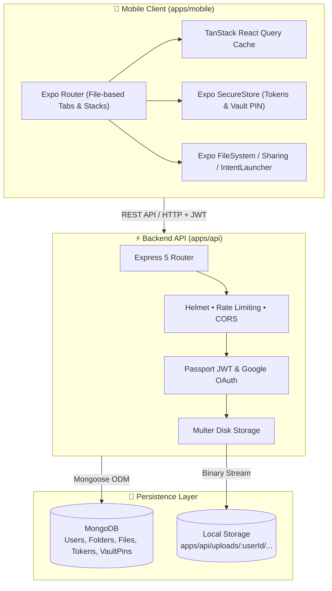

<div align="center">

# 🗂️ CloudBox — Mobile File Manager

**A modern, self-hosted personal cloud storage ecosystem.**  
Engineered with a high-performance **Express + MongoDB API** and a slick **Expo (React Native)** cross-platform mobile client inside a unified **Turborepo** monorepo.

---

[](https://turbo.build/repo)
[](https://expo.dev/)
[](https://reactnative.dev/)
[](https://nodejs.org/)
[](https://expressjs.com/)
[](https://www.mongodb.com/)
[](https://www.typescriptlang.org/)
[](https://www.docker.com/)

<br />

[✨ Features](#-features) •
[🏛️ Architecture](#%EF%B8%8F-architecture) •
[📁 Project Structure](#-project-structure) •
[🚀 Quick Start](#-quick-start) •
[📱 Mobile App](#-mobile-app) •
[🔌 API Reference](#-api-reference) •
[🐳 Docker Workflow](#-docker-workflow) •
[🛠️ Monorepo Scripts](#%EF%B8%8F-monorepo-scripts)

---

</div>

## 🌟 Overview

**CloudBox** is a complete end-to-end cloud drive experience built for privacy and performance. It gives you full control over your documents, images, and files with local disk storage backed by MongoDB metadata indexing, protected PIN vaults, visual storage analytics, and multi-platform mobile support across iOS, Android, and Web.

---

## ✨ Features

<table>
  <tr>
    <td width="50%">
      <h3>📁 File & Folder Hierarchy</h3>
      <ul>
        <li><b>Concurrent Uploads:</b> Batch upload up to 50 files with MIME validation.</li>
        <li><b>Smart Filtering:</b> Instant tabs for Images, PDFs, and Documents.</li>
        <li><b>Nested Directory Trees:</b> Full breadcrumb and parent/child folder support.</li>
        <li><b>Quick Actions:</b> Rename, duplicate, copy, delete, download, and share.</li>
      </ul>
    </td>
    <td width="50%">
      <h3>🔒 Biometric & PIN Vault</h3>
      <ul>
        <li><b>Dedicated Security Layer:</b> Encrypted 4-digit PIN access.</li>
        <li><b>Hidden Files:</b> Vaulted items are strictly omitted from standard listings.</li>
        <li><b>Secure Restore:</b> Verify PIN anytime before accessing or restoring private records.</li>
      </ul>
    </td>
  </tr>
  <tr>
    <td width="50%">
      <h3>📊 Storage Dashboard & Insights</h3>
      <ul>
        <li><b>Visual Storage Meter:</b> Track disk space usage and tier limits.</li>
        <li><b>Category Breakdown:</b> Detailed count and byte stats for images, PDFs, docs.</li>
        <li><b>Recent Activity:</b> Quick jump into recently uploaded or accessed items.</li>
      </ul>
    </td>
    <td width="50%">
      <h3>📅 Temporal Calendar View</h3>
      <ul>
        <li><b>Date-Based Exploration:</b> Browse documents organized by creation date.</li>
        <li><b>One-Tap Navigation:</b> Shift through days with forward/backward controls.</li>
      </ul>
    </td>
  </tr>
  <tr>
    <td width="50%">
      <h3>⭐ Starred & Quick Access</h3>
      <ul>
        <li><b>Favorites Hub:</b> One-tap starring for high-priority documents and folders.</li>
        <li><b>Cross-Referencing:</b> Access favorited files regardless of their parent folders.</li>
      </ul>
    </td>
    <td width="50%">
      <h3>🔐 Enterprise-Grade Authentication</h3>
      <ul>
        <li><b>JWT Token Pair:</b> Access token + secure refresh token rotation.</li>
        <li><b>OTP Recovery:</b> Secure 6-digit email OTP password resets via Nodemailer.</li>
        <li><b>Google OAuth 2.0:</b> Integrated social login workflow.</li>
        <li><b>Defensive Security:</b> Helmet headers, CORS policies, and rate limiters.</li>
      </ul>
    </td>
  </tr>
</table>

---

## 🏛️ Architecture



---

## 📁 Project Structure

```bash
fileManagerMobileApp/
├── apps/
│   ├── api/                     # Node.js + Express 5 Storage Management API
│   │   ├── Dockerfile           # Production container configuration
│   │   ├── docker-compose.yml   # Full stack (API + MongoDB)
│   │   ├── docker-compose.mongo.yml # Local dev database container
│   │   ├── postman_collection.json  # Comprehensive Postman test suite
│   │   ├── server.js            # Express server initialization & security
│   │   └── src/
│   │       ├── config/          # DB connection, env validation, passport strategies
│   │       ├── controllers/     # Auth, Files, Folders, Vault, Dashboard, Calendar
│   │       ├── middleware/      # Multer, JWT guard, Vault guard, error handling
│   │       ├── models/          # User, File, Folder, VaultPin, RefreshToken
│   │       ├── routes/          # RESTful endpoint definitions
│   │       ├── services/        # Storage allocation & SMTP email dispatch
│   │       └── utils/           # Standardized API response formatters & JWT helpers
│   │
│   └── mobile/                  # Cross-platform Expo React Native app
│       ├── app.json             # Expo configuration (SDK 57)
│       └── src/
│           ├── app/             # Expo Router file-based screens
│           │   ├── (auth)/      # Login, Signup, Forgot Password, OTP verification
│           │   └── (app)/       # Dashboard, Files, Favorites, Calendar, Vault, Profile
│           ├── components/      # UI primitives, animated icons, FileRow, Action Sheets
│           ├── constants/       # Adaptive light & dark theme color tokens
│           ├── hooks/           # Theme hooks and device scheme observers
│           └── lib/             # API client, TanStack Query, Auth & Vault contexts
│
├── package.json                 # Monorepo root scripts & dev dependencies
├── turbo.json                   # Turborepo task pipelines (build, dev, lint, check-types)
└── README.md                    # You are here!
```

---

## 🚀 Quick Start

### 1. Prerequisites

Ensure you have the following installed on your host machine:

- **Node.js** `≥ 24.0.0`
- **npm** `≥ 11.0.0`
- **Docker & Docker Compose** (for running MongoDB locally)
- **Expo Go** on your physical mobile device or an iOS Simulator / Android Emulator

---

### 2. Monorepo Installation

Clone the repository and install all workspace dependencies from the root:

```bash
git clone https://github.com/your-username/fileManagerMobileApp.git
cd fileManagerMobileApp
npm install
```

---

### 3. Environment Setup

#### 🌐 API Configuration (`apps/api`)

Copy the example environment file:

```bash
cp apps/api/.env.example apps/api/.env
```

Review and configure your values in `apps/api/.env`:

| Key | Default / Example | Purpose |
| :-- | :---------------- | :------ |
| `PORT` | `8080` | Express server listen port |
| `MONGODB_URI` | `mongodb://localhost:27017/filemanager` | MongoDB connection string |
| `JWT_SECRET` | *(generate a secure 32+ char string)* | Secret for signing access tokens |
| `JWT_REFRESH_SECRET` | *(generate a secure 32+ char string)* | Secret for signing refresh tokens |
| `GOOGLE_CLIENT_ID` | `your_google_client_id` *(optional)* | Google Cloud OAuth client ID |
| `GOOGLE_CLIENT_SECRET` | `your_google_client_secret` *(optional)* | Google Cloud OAuth secret |
| `SMTP_HOST` | `smtp.gmail.com` *(optional)* | SMTP host for OTP password recovery |
| `SMTP_PORT` | `587` | SMTP communication port |
| `SMTP_USER` | `youremail@gmail.com` | SMTP authentication user |
| `SMTP_PASS` | `your_app_password` | App password (not personal password) |

#### 📱 Mobile Configuration (`apps/mobile`)

Copy the mobile environment file:

```bash
cp apps/mobile/.env.example apps/mobile/.env
```

Set `EXPO_PUBLIC_API_URL` based on your development target:

| Target Platform | `EXPO_PUBLIC_API_URL` |
| :-------------- | :-------------------- |
| **iOS Simulator / Web Browser** | `http://localhost:8080` |
| **Android Emulator** | `http://10.0.2.2:8080` |
| **Physical Phone (Expo Go via Wi-Fi)** | `http://<YOUR_LOCAL_LAN_IP>:8080` *(e.g., `http://192.168.1.50:8080`)* |

> [!TIP]
> Make sure your mobile device and computer are connected to the same Wi-Fi network when using your local LAN IP.

---

### 4. Run the Full Stack

Launch the entire ecosystem with a single command from the monorepo root:

```bash
npm run dev
```

This single command orchestrates:
1. Automatically spins up **MongoDB** inside Docker via `docker-compose.mongo.yml`.
2. Starts the **API** on `http://localhost:8080` with nodemon live reload.
3. Launches the **Expo Dev Server** for the mobile app with tunnel / LAN ready.

---

## 📱 Mobile App

The mobile application is built with **Expo SDK 57**, **Expo Router**, and **React 19**.

```bash
# Navigate to the mobile workspace
cd apps/mobile

# Start Expo with interactive CLI
npm run dev

# Or target specific platforms directly
npm run android    # Launch on Android emulator / connected device
npm run ios        # Launch on iOS simulator
npm run web        # Run in browser
```

### Mobile Highlights & Gestures
- **Context Actions:** Long-press any file or folder row to trigger an action sheet:
  - ✏️ Rename
  - 📄 Duplicate
  - 🔒 Move to Vault / Restore from Vault
  - ⭐ Add to / Remove from Favorites
  - 🗑️ Delete
- **In-App File Previews:** Full-screen preview viewer for images and document metadata.
- **Native Sharing:** Download and immediately trigger system share dialogs (`expo-sharing`) or open via native Android/iOS intents (`expo-intent-launcher`).
- **Dynamic Theming:** Seamless support for system Light Mode and Dark Mode.

---

## 🔌 API Reference

The backend exposes a clean REST API running on `http://localhost:8080`.

### Health & Diagnostic
- `GET /api/health` — Check server health and MongoDB connection state

### 🔐 Authentication
- `POST /api/auth/signup` — Register a new account
- `POST /api/auth/login` — Sign in with email and password
- `POST /api/auth/refresh-token` — Rotate access token using refresh token
- `POST /api/auth/logout` — Revoke active session tokens
- `POST /api/auth/forgot-password` — Request a 6-digit OTP via email
- `POST /api/auth/verify-otp` — Verify OTP code and receive a password reset token
- `POST /api/auth/reset-password` — Set a new password using reset token
- `GET /api/auth/google` — Trigger Google OAuth 2.0 flow

### 📁 Files Management
- `GET /api/files` — List files (supports `?type=image|pdf|doc` and `?folderId=...`)
- `GET /api/files/:id` — Get detailed metadata for a file
- `POST /api/files/upload` — Multipart form-data upload (up to 50 files)
- `GET /api/files/:id/download` — Stream / download file contents
- `PUT /api/files/:id/rename` — Rename an existing file
- `POST /api/files/:id/duplicate` — Create an instant clone of a file
- `POST /api/files/:id/copy` — Copy file to another directory
- `DELETE /api/files/:id` — Permanently delete a file

### 📂 Folder Management
- `GET /api/folders` — List folders (supports `?parentId=...` for nesting)
- `POST /api/folders` — Create a new folder
- `GET /api/folders/:id/files` — Fetch combined contents (subfolders + files)
- `PUT /api/folders/:id/rename` — Rename folder
- `DELETE /api/folders/:id` — Delete folder

### 🔒 Vault
- `POST /api/vault/pin` — Set or update the 4-digit Vault PIN
- `POST /api/vault/verify` — Verify Vault PIN
- `GET /api/vault` — Retrieve all vaulted files & folders *(requires `x-vault-pin` header)*
- `POST /api/vault/files/:id/move` — Move a file into the secret Vault
- `POST /api/vault/folders/:id/move` — Move a folder into the secret Vault
- `POST /api/vault/files/:id/restore` — Restore a file to regular storage
- `POST /api/vault/folders/:id/restore` — Restore a folder to regular storage

### 📊 Dashboard & Calendar
- `GET /api/dashboard` — Storage stats, quota limits, categorized counts, and recent files
- `GET /api/calendar?date=YYYY-MM-DD` — Retrieve files created on a specific calendar date

### ⭐ Favorites
- `GET /api/favorites` — List all favorited files and folders
- `POST /api/favorites/files/:id` / `DELETE /api/favorites/files/:id` — Star / unstar file
- `POST /api/favorites/folders/:id` / `DELETE /api/favorites/folders/:id` — Star / unstar folder

> [!TIP]
> **Postman Collection Included:** Import [`apps/api/postman_collection.json`](apps/api/postman_collection.json) directly into Postman. It includes pre-written test scripts that automatically save and rotate your JWT auth tokens and file IDs across sequential testing phases.

---

## 🐳 Docker Workflow

CloudBox offers flexible containerized options depending on your preference:

### Mode A: Database in Docker + Host Nodemon (Recommended for Dev)

```bash
# Starts Mongo in background
npm run db:up

# Tear down Mongo when done
npm run db:down
```

### Mode B: Complete Stack in Docker (API + MongoDB)

```bash
# Builds and starts both the Express API and Mongo containers
npm run docker:up

# Stop all containers
npm run docker:down
```

> [!NOTE]
> Uploaded files are mounted to the host filesystem under `apps/api/uploads/` (gitignored). If you switch between Docker and host nodemon, ensure the `uploads/` folder is writable by your host user:
> ```bash
> docker run --rm -v "$PWD/apps/api/uploads:/uploads" alpine chown -R $(id -u):$(id -g) /uploads
> ```

---

## 🛠️ Monorepo Scripts

All workspace scripts are powered by **Turborepo** for optimal caching and parallel execution:

| Command | Description |
| :------ | :---------- |
| `npm run dev` | Boots MongoDB container, API (nodemon), and Mobile (Expo) simultaneously |
| `npm run dev:api` | Boots MongoDB and starts the API only (`--filter=filemanager`) |
| `npm run dev:mobile` | Starts the Expo mobile development server only (`--filter=mobile`) |
| `npm run db:up` | Starts the standalone MongoDB container |
| `npm run db:down` | Stops the standalone MongoDB container |
| `npm run docker:up` | Builds and runs the full API + Mongo stack in Docker |
| `npm run docker:down` | Stops the full Docker stack |
| `npm run lint` | Runs ESLint across all workspaces |
| `npm run check-types` | Typechecks TypeScript across workspaces without emitting files |
| `npm run format` | Formats all code files with Prettier (`.ts`, `.tsx`, `.md`) |
| `npm run build` | Turborepo workspace build pipeline |

---

## 🛡️ Security & Privacy

- **Zero Third-Party File Hosting:** Files are stored strictly on your designated server disk under `apps/api/uploads/` with hashed filenames to prevent path traversal.
- **Data Isolation:** User files are scoped strictly to their authenticated account identifier (`userId`).
- **Encrypted Credentials:** Passwords and Vault PINs are salted and hashed using `bcrypt`.
- **Hardened HTTP Headers:** Protected against common web vulnerabilities via `helmet` and IP-based rate limiting on sensitive auth endpoints.

---

<div align="center">

Made with ❤️ for self-hosted cloud storage.

</div>
